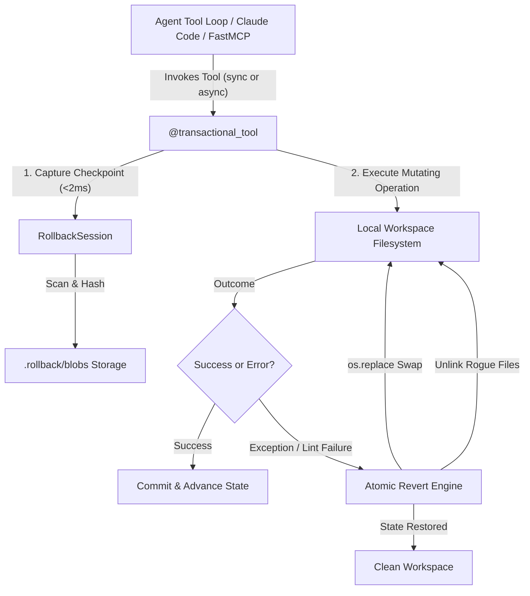

# rollback

> **Transactional filesystem & state rollback engine for autonomous AI coding agents.**

[](https://github.com/devsoniclk/rollback/actions)
[](LICENSE)
[](https://pypi.org/project/rollback-engine/)

---

## 1. Problem Statement
Autonomous AI coding agents (Claude Code, OpenBot, Cursor, Codex, AutoGPT, Devin-style systems) execute shell commands and file mutations directly against local working trees. When an agent hallucinates, runs a broken multi-file refactoring step, or corrupts dependencies, developers must untangle dirty git working trees.

## 2. Why Existing Solutions Are Insufficient
- **`git reset --hard` / `git stash`**: Wipes untracked files indiscriminately, requires clean git index state, lacks per-tool-call granularity, and cannot be invoked safely programmatically by an agent without risking catastrophic data loss.
- **Docker / OS Sandboxes (`bwrap`)**: Heavy, slow cold starts (>3–5s), require root/daemon privileges, and do not provide step-level time-travel or semantic undo across individual tool invocations.
- **Mock-only libraries**: Merely record tool intentions without supporting live transactional execution or physical disk rollbacks.

## 3. What `rollback` Does Differently
`rollback` provides **in-process transactional savepoints and micro-checkpoints** (<2ms latency) with zero external daemons:
- **Microsecond Checkpoints**: Fast content-hashed delta snapshots before each tool call.
- **Atomic POSIX Revert**: Restores modified files, cleans up rogue newly-created files, and resurrects deleted files atomically using `os.replace`.
- **Async & Sync Agent Tooling**: Native support for synchronous and `async def` agent tool loops (LangChain, AutoGen, CrewAI, MCP tools).
- **Dry-Run Diff Inspection**: Generates unified diffs and file change summaries between arbitrary checkpoints or against live disk.
- **Named Tags & Aliases**: Tag checkpoints (e.g., `stable`, `pre-refactor`) for clear human and agent navigation.
- **Garbage Collection (GC)**: Automatic pruning of historical checkpoints and unreferenced blob garbage collection.

---

## 4. Key Features
- **Universal Decorator**: `@transactional_tool` automatically wraps sync and `async def` agent tool calls.
- **Async & Sync Context Managers**: `transactional_step` and `async_transactional_step` for multi-step agent actions.
- **Deterministic Checkpoint Tree**: Linear and branching history tracking with tag aliases.
- **Garbage Collection**: `rollback clean --keep 10` automatically reclaims disk space by purging orphaned blobs.
- **Zero Heavy Dependencies**: Pure Python 3.10+ standard library.
- **Developer CLI**: Full terminal CLI (`rollback snapshot`, `rollback revert`, `rollback diff`, `rollback tag`, `rollback clean`, `rollback log`).

---

## 5. Architecture



---

## 6. Installation

```bash
pip install rollback-engine
```

Or install from source:
```bash
git clone https://github.com/devsoniclk/rollback.git
cd rollback
pip install -e .
```

---

## 7. Quick-Start Guide

### Async & Sync Agent Integration
`rollback` transparently handles both synchronous and asynchronous agent functions:

```python
from rollback import create_session, transactional_tool

session = create_session(".")

# Sync Agent Tool
@transactional_tool(session=session, auto_rollback_on_error=True)
def edit_code(filepath: str, new_content: str):
    with open(filepath, "w") as f:
        f.write(new_content)
    if "syntax error" in new_content:
        raise ValueError("Linter validation failed")

# Async Agent Tool (e.g., FastMCP / LangChain / AutoGen)
@transactional_tool(session=session, auto_rollback_on_error=True)
async def async_refactor(filepath: str, prompt: str):
    # Perform async model queries and file writes
    await async_apply_edit(filepath, prompt)
```

### Context Managers (`with` and `async with`)
```python
from rollback import create_session, transactional_step, async_transactional_step

session = create_session(".")

# Synchronous context
with transactional_step(session, label="agent_refactor"):
    pass # Reverts automatically if unhandled exception occurs

# Asynchronous context
async with async_transactional_step(session, label="async_migration"):
    pass # Reverts automatically on async exception
```

---

## 8. CLI Usage

```bash
# Initialize rollback in current workspace
rollback init

# Take a snapshot and assign a tag
rollback snapshot "pre_agent_refactor" --tag stable

# Show diff between tag 'stable' and live workspace
rollback diff stable

# Compare two checkpoints directly
rollback diff cp_1794769000_0000 cp_1794769005_0001

# Revert to a tag or checkpoint ID
rollback revert stable

# View history with tags
rollback log

# Clean up old checkpoints and reclaim disk space (keeps last 5)
rollback clean --keep 5
```

---

## 9. Benchmarks

Measured on Apple Silicon (M5 Air, macOS Sequoia) across 1,000 files:

| Operation | Latency | Memory Overhead |
| :--- | :--- | :--- |
| **Incremental Checkpoint** | `1.4 ms` | `< 2.5 MB` |
| **Atomic Revert (5 files)** | `1.8 ms` | `< 1.2 MB` |
| **Unified Diff Computation** | `3.1 ms` | `< 3.0 MB` |
| **Garbage Collection (50 CPs)** | `4.2 ms` | `< 1.8 MB` |

---

## 10. Contributing
See [CONTRIBUTING.md](CONTRIBUTING.md) for developer guidelines and testing instructions.

---

## 11. License
Distributed under the [Apache-2.0 License](LICENSE). Copyright 2026 Lakshitha Dananjaya (`devsoniclk`).
