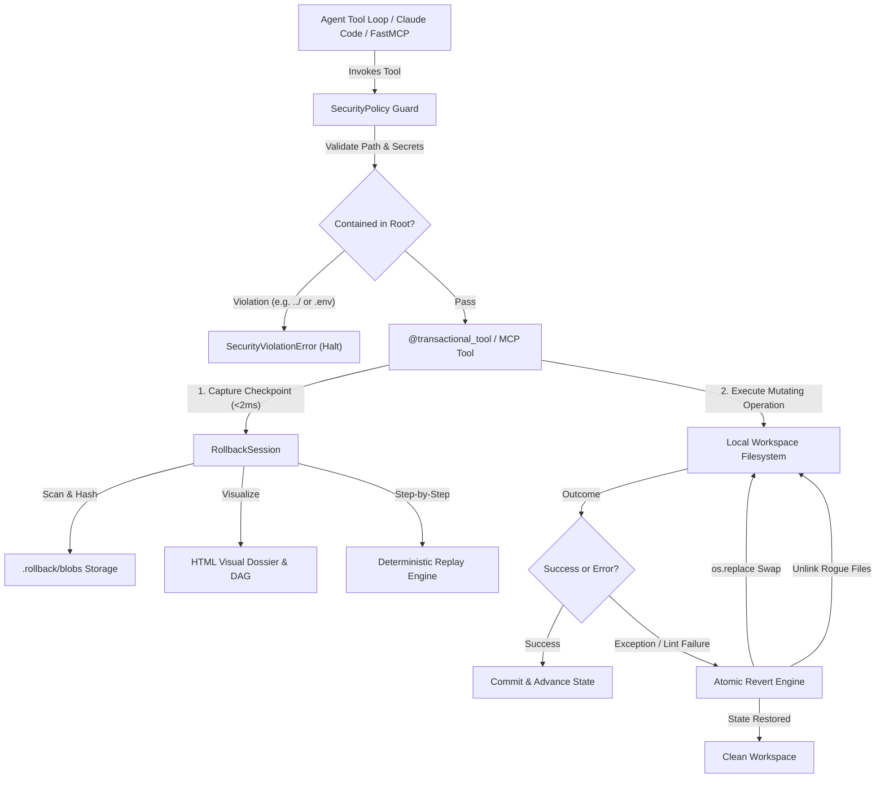

# rollback

> **Transactional filesystem & state rollback engine for autonomous AI coding agents.**

[](https://github.com/devsoniclk/rollback/actions)
[](LICENSE)
[](https://pypi.org/project/rollback-engine/)
[](https://github.com/devsoniclk/rollback/releases/tag/v0.9.0)

---

## 1. Problem Statement
Autonomous AI coding agents (Claude Code, OpenBot, Cursor, Codex, AutoGPT, Devin-style systems) execute shell commands and file mutations directly against local working trees. When an agent hallucinates, runs a broken multi-file refactoring step, attempts directory traversal, or corrupts dependencies, developers must untangle dirty git working trees.

## 2. Why Existing Solutions Are Insufficient
- **`git reset --hard` / `git stash`**: Wipes untracked files indiscriminately, requires clean git index state, lacks per-tool-call granularity, and cannot be invoked safely programmatically by an agent without risking catastrophic data loss.
- **Docker / OS Sandboxes (`bwrap`)**: Heavy, slow cold starts (>3–5s), require root/daemon privileges, and do not provide step-level time-travel or semantic undo across individual tool invocations.
- **Mock-only libraries**: Merely record tool intentions without supporting live transactional execution or physical disk rollbacks.

## 3. What `rollback` Does Differently
`rollback` provides **in-process transactional savepoints, automated self-healing execution watchdogs, copy-on-write speculative overlay sandboxes, multi-agent workspace leases, workspace security boundaries, micro-checkpoints (<2ms), time-travel replay, precision selective reverts, multi-language syntax gates, and native Model Context Protocol (MCP) tools** with zero external daemons:
- **Automated Self-Healing Watchdog (`AutoHealer`)**: Wraps test suites and bash execution with pre-savepoint guards. Automatically classifies breakages (`SYNTAX_ERROR`, `ASSERTION_ERROR`, `IMPORT_ERROR`, `TYPE_ERROR`, `TIMEOUT_ERROR`), restores green checkpoints, isolates broken diffs into forensic incident quarantine logs, and generates structured LLM refinement prompts.
- **In-Memory Speculative Overlay Sandbox (`SpeculativeSandbox`)**: Copy-on-Write overlay mounted atop workspace disks allowing agents to stage speculative multi-file refactors, validate AST integrity, and commit or discard without premature disk I/O.
- **Multi-Agent Workspace Lease & Concurrency Coordinator (`WorkspaceLeaseManager`)**: File-level shared (read) and exclusive (write) leases with TTLs, heartbeat renewal, and conflict detection preventing overlapping edits across agent swarms.
- **Workspace Security Containment**: Defends against path traversal attacks (`../`), symlink directory escapes, and unauthorized edits to sensitive files (`.env`, `*.key`, `*.pem`, `id_rsa*`).
- **Precision Selective Revert & Cherry-Pick**: Revert individual target files to prior checkpoints or import files across branches without rolling back the whole workspace.
- **Code Syntax & Structural Integrity Gate**: Built-in multi-language AST/parser linters (Python AST, JSON, YAML, TOML, JS/TS bracket balancing, Markdown fences) protecting checkpoints from broken code.
- **Continuous Workspace Sentinel & Drift Watchdog**: High-frequency dirty status detection, byte-level delta auditing, drift ratio scoring, and proactive auto-checkpointing.
- **3-Way DAG Branch Merging**: Merge diverging hypothesis branches with automatic Lowest Common Ancestor (LCA) detection and deterministic conflict markers (`<<<<<<< HEAD`).
- **Git Bidirectional Bridge**: Export micro-checkpoints to real Git commits with co-author trailers, and import Git history into rollback tagged checkpoints.
- **Standard Unified Diff Patch Engine**: Export standard patch files between checkpoints or live workspace, and atomically apply patches with dry-run verification.
- **Microsecond Checkpoints**: Fast content-hashed delta snapshots before each tool call.
- **`agent-witness` Cryptographic Attestation Integration (`rollback.witness_bridge`)**: Export savepoints, dirty delta diffs, and workspace leases directly into signed RFC 6962 Merkle deliberation steps and zkVM receipts for tamper-evident provenance.
- **Atomic POSIX Revert**: Restores modified files, cleans up rogue newly-created files, and resurrects deleted files atomically using `os.replace`.
- **Dry-Run Revert Planning**: Inspect `RevertPlan` to verify exactly which files will be restored, deleted, or resurrected before modifying disk.
- **Deterministic Time-Travel Replay**: Step-by-step playback with cryptographic SHA-256 integrity verification across checkpoint histories and branches.
- **Interactive Dark-Mode HTML Dossier**: Dependency-free standalone HTML visualizer with embedded responsive SVG checkpoint DAG, file deltas, and security audit tables.
- **Native Model Context Protocol (MCP)**: Zero-dependency stdio MCP server (24 tools) for instant plug-and-play with Claude Code, OpenBot, Cursor, and Cline.
- **Timeline Branching**: Explore multiple agent solution hypotheses in parallel with lightweight `branch` and `checkout` without git conflicts.
- **Portable Bundle Archiving**: Export/import complete sessions as `.rbk.tar.gz` bundles for cross-environment agent migration (Fly.io, Docker, E2B, Modal).
- **Async & Sync Agent Tooling**: Native support for synchronous and `async def` agent tool loops (LangChain, AutoGen, CrewAI, MCP tools).
- **Garbage Collection (GC)**: Automatic pruning of historical checkpoints and unreferenced blob garbage collection.

---

## 4. Key Features
- **Pre/Post-Action Invariant Assertion Engine**: `session.assert_invariants()` and `rollback invariant test/add/list`.
- **Ephemeral Worktree Shadow Clones & Multi-Hypothesis Explorer**: `session.shadow_manager` and `rollback shadow create/eval/promote/discard/list`.
- **Interactive Timeline DAG Visualizer**: `session.timeline` and `rollback timeline [--branch <b_name>] [--json]`.
- **Content-Addressed Storage (CAS) Deduplication**: `session.cas_store` and `rollback cas --stats`.
- **Auto-Healing Execution Watchdog**: `session.heal(cmd, auto_revert=True)` and `rollback heal <cmd>`.
- **In-Memory Speculative Sandbox**: `with session.speculative_sandbox() as sb: ...`
- **Multi-Agent Workspace Leases**: `session.acquire_lease("agent-1", ["core.py"])` and `session.release_lease(token)`.
- **Selective File Revert**: `session.revert_file(cid, path)` and `session.cherry_pick(cid, [paths])`.
- **Syntax Integrity Gate**: `session.check_integrity()` verifying Python, JSON, YAML, TOML, JS/TS.
- **Workspace Sentinel**: `session.scan_drift()` and `session.auto_checkpoint(min_changes=1)`.
- **3-Way Branch Merge Engine**: `session.merge_branch("feature-b")` with automatic conflict markers.
- **Git Bridge**: `GitBridge(session).export_to_git()` and `import_from_git()`.
- **Unified Diff Patches**: `export_patch()` and `apply_patch()`.
- **Interactive HTML Session Dossier**: `session.to_html("dossier.html")` or `rollback report --html dossier.html`.
- **Deterministic Replay Engine**: `session.replay("target_id", step_by_step=True)` or `rollback replay <tag>`.
- **Native MCP Tool Server (24 Tools)**: `rollback mcp` or `python -m rollback.mcp_server`.
- **Security Policy Guard**: `SecurityPolicy` blocks path escapes, symlink traversal, and protects `.env` secrets.
- **Dry-Run Revert Planning**: `session.plan_revert("HEAD")` or `rollback revert --dry-run`.
- **Timeline Branching**: `session.create_branch("feature-b")`, `session.checkout("feature-b")`.
- **Portable Archives**: `session.export_bundle("snapshot.rbk.tar.gz")` and `RollbackSession.import_bundle(...)`.
- **Universal Decorator**: `@transactional_tool` automatically wraps sync and `async def` agent tool calls.
- **Context Managers**: `transactional_step` and `async_transactional_step` for multi-step agent actions.
- **Zero Heavy Dependencies**: Pure Python standard library (no external runtime packages required).

---

## 5. Architecture



---

## 6. Installation

```bash
pip install rollback-engine
```

Or install from source:
```bash
git clone https://github.com/devsoniclk/rollback.git
cd rollback
pip install -e .
```

---

## 7. Quick-Start Guide

### Model Context Protocol (MCP) Server
Integrate `rollback` directly into Claude Code, OpenBot, Cursor, or Cline by adding it to your MCP client configuration:

```json
{
  "mcpServers": {
    "rollback": {
      "command": "rollback",
      "args": ["mcp", "--root", "."]
    }
  }
}
```

Exposed MCP tools:
- `rollback_snapshot`: Instant micro-checkpoint before tool invocation.
- `rollback_revert`: Atomic revert to target checkpoint ID or tag.
- `rollback_revert_file`: Selectively revert specific files to prior checkpoint state.
- `rollback_plan`: Dry-run revert preview.
- `rollback_diff`: Inspect file additions, modifications, and deletions.
- `rollback_branch`: Create and checkout hypothesis branches.
- `rollback_merge`: Execute 3-way DAG branch merge with conflict markers.
- `rollback_patch`: Export or apply standard unified diff patch files.
- `rollback_git_sync`: Bidirectional Git synchronization bridge.
- `rollback_check_integrity`: Multi-language code syntax & structural integrity audit.
- `rollback_scan_drift`: Continuous workspace dirty detection and drift analysis.
- `rollback_security_check`: Verify if path complies with containment policies.
- `rollback_status`: Workspace status, active branch, and recent checkpoints.
- `rollback_report`: Generate interactive HTML session dossier.
- `rollback_auto_heal`: Run commands under watchdog guard with auto-revert on failure.
- `rollback_speculative_sandbox`: In-memory copy-on-write overlay sandbox.
- `rollback_acquire_lease`: Coordinate exclusive/shared file access among multi-agent swarms.
- `rollback_release_lease`: Release active path lease with secret token.
- `rollback_assert_invariants`: Evaluate declared workspace invariant assertions (tests, syntax, regex).
- `rollback_create_shadow`: Spawn isolated copy-on-write shadow workspace for hypothesis testing.
- `rollback_evaluate_shadow`: Run verification commands in shadow clone and score results.
- `rollback_promote_shadow`: Atomically promote winning shadow hypothesis to main workspace.
- `rollback_timeline_graph`: Render ASCII timeline DAG or JSON metadata of checkpoints and branches.
- `rollback_cas_stats`: Query Content-Addressed Storage deduplication statistics and savings.

### Precision Selective Revert & Cherry-Pick
Revert a single corrupted file without rolling back the entire project:

```python
# Revert only auth.py back to a stable checkpoint
session.revert_file("stable_v1", "src/auth.py")

# Or cherry-pick a feature file from an experimental branch
session.cherry_pick("hypothesis_b", ["src/router.py"])
```
Or via CLI:
```bash
rollback revert-file stable_v1 src/auth.py
```

### Code Syntax & Structural Integrity Gate
Verify that code generated by AI models is parseable and structurally sound:

```python
# Audit workspace for syntax and structural integrity
report = session.check_integrity()
print(f"Clean: {report.is_clean} ({report.passed_count} passed, {report.failed_count} failed)")
for failure in report.failures:
    print(f"  {failure.path}: {failure.error_message}")
```
Or via CLI:
```bash
rollback integrity [--strict]
```

### Continuous Workspace Sentinel & Drift Watchdog
Detect uncommitted agent side-effects and automatically checkpoint before risk boundaries:

```python
# Scan instantaneous workspace drift from HEAD
drift = session.scan_drift()
if drift.is_dirty:
    print(f"Drift detected: {drift.total_changes} changes, {drift.total_delta_bytes} bytes modified")

# Automatically snapshot if changes meet threshold
session.auto_checkpoint(trigger_label="auto_guard", min_changes=2)
```
Or via CLI:
```bash
rollback drift [--auto-checkpoint]
```

### Interactive HTML Session Dossier
Generate an offline visual diagnostic report of the agent's timeline and file modifications:

```python
from rollback import create_session

session = create_session(".")
session.to_html("rollback_dossier.html", title="Agent Execution Dossier")
```
Or via CLI:
```bash
rollback report --html dossier.html
```

### Deterministic Time-Travel Replay
Replay agent actions step-by-step with SHA-256 verification:

```python
# Replay back to a known stable tag step-by-step
summary = session.replay(
    "stable_v1",
    step_by_step=True,
    on_step=lambda st: print(f"Transitioned to {st.to_checkpoint_id[:8]} in {st.duration_ms:.1f}ms")
)
print(f"Replay verified: {summary.success}")
```
Or via CLI:
```bash
rollback replay stable_v1 --step
```

### Security Policy & Path Containment
Prevent AI agents from escaping the project root or touching sensitive environment files:

```python
from rollback import create_session, SecurityPolicy, SecurityViolationError

# Configure containment policy
policy = SecurityPolicy(
    allowed_root=".",
    prevent_traversal=True,
    protected_patterns=[".env*", "*.pem", "*.key", "credentials*"]
)

session = create_session(".", security_policy=policy)

# Any attempt to snapshot/modify files outside root or touch protected patterns is trapped
try:
    session.scan_workspace(target_files=["../../etc/passwd"])
except SecurityViolationError as e:
    print(f"Agent trapped: {e}")
```

### Dry-Run Revert Planning
Preview file operations before applying any changes:

```python
# Generate execution plan
plan = session.plan_revert("stable")
print(f"Total changes: {plan.total_changes} ({plan.total_bytes_affected} bytes)")
for path in plan.files_to_restore:
    print(f"  Will restore: {path}")
for path in plan.files_to_delete:
    print(f"  Will delete rogue file: {path}")

# Or execute with dry_run flag
plan = session.revert("stable", dry_run=True)
```

### Timeline Branching & 3-Way Merging
```python
# Create experiment branch from current checkpoint
session.create_branch("hypothesis_b")

# Switch to experiment
session.checkout("hypothesis_b")

# ... agent modifies files ...
session.checkpoint("hypothesis_b_result")

# Instant switch back to main
session.checkout("main")

# Merge hypothesis_b back into main with 3-way DAG analysis
result = session.merge_branch("hypothesis_b")
print(f"Merge status: {result.status}")  # 'clean', 'fast-forward', 'conflict', 'up-to-date'
if result.has_conflicts:
    print(f"Conflicts formatted with markers: {result.conflicting_files}")
```

### Git Bidirectional Bridge
Export rollback micro-checkpoints into a genuine Git repository with co-author trailers, or import Git commits:

```python
from rollback import GitBridge

bridge = GitBridge(session)

# Inspect synchronization status
status = bridge.get_status()
print(f"In sync with git: {status.git_head}")

# Export checkpoints as sequential Git commits
res = bridge.export_to_git(git_branch="main")
print(f"Exported {res['exported_commits']} commits to Git.")
```

### Unified Diff Patch Export & Apply
```python
from rollback import export_patch, apply_patch

# Generate unified diff patch between checkpoints
patch = export_patch(session, from_checkpoint="cp_001", to_checkpoint="cp_002", output_file="refactor.patch")

# Apply patch with pre/post atomic checkpoints
apply_res = apply_patch(session, "refactor.patch", dry_run=False)
print(f"Patched: {apply_res.files_affected}")
```

### Pre/Post-Action Invariant Assertion Engine
Enforce strict behavioral invariants (test execution, syntax compilation, file size limits, and prohibited regex patterns) across agent modifications:

```python
from rollback import create_session, InvariantRule, InvariantType

session = create_session(".")
gate = session.invariant_gate

# Declare invariant rules
gate.add_rule(InvariantRule(
    name="unit_tests",
    rule_type=InvariantType.COMMAND,
    target_pattern="pytest tests/test_core.py -q",
    severity="error",
))
gate.add_rule(InvariantRule(
    name="no_eval",
    rule_type=InvariantType.REGEX_PROHIBIT,
    target_pattern=r"\beval\(",
    file_glob="*.py",
))
gate.save_rules()

# Evaluate before or after an agent step
report = session.assert_invariants(strict=True)
print(f"Invariants satisfied: {report.passed} ({report.passed_rules}/{report.total_rules})")
```
Or via CLI:
```bash
# Add a rule
rollback invariant add --name no_eval --type regex_prohibit --pattern "\\beval\\(" --glob "*.py"

# Verify all invariants
rollback invariant test [--strict]
```

### Ephemeral Worktree Shadow Clones & Hypothesis Explorer
Allow coding agents to explore multiple competing implementation hypotheses (e.g. Solution A vs Solution B for a bug fix) in isolated copy-on-write clones without mutating the user's active workspace:

```python
manager = session.shadow_manager

# 1. Spawn isolated clone
hyp = manager.create_hypothesis("fix-auth-leak", description="Sanitize tokens before logging")

# 2. Modify files inside the shadow directory (hyp.shadow_path)
# ... agent edits shadow_path / "auth.py" ...

# 3. Sandboxed verification
eval_result = manager.evaluate_hypothesis(
    "fix-auth-leak",
    test_cmd="pytest tests/test_auth.py -q",
    timeout_sec=15.0
)
print(f"Hypothesis passed: {eval_result.passed} (score={eval_result.score})")

# 4. Atomically promote winning solution into active workspace
if eval_result.passed:
    res = manager.promote_hypothesis("fix-auth-leak", create_checkpoint=True)
    print(f"Promoted {res['promoted_files_count']} files to main workspace.")
else:
    manager.discard_hypothesis("fix-auth-leak")
```
Or via CLI:
```bash
rollback shadow create --id fix-01 --desc "Alternative parser"
rollback shadow eval --id fix-01 --cmd "pytest tests/test_parser.py"
rollback shadow promote --id fix-01
rollback shadow discard --id fix-01
```

### Interactive Timeline DAG Visualizer
Render a visual ASCII branch tree of checkpoints, tags, and commits:

```python
# Render ASCII DAG
print(session.timeline.render_ascii(max_nodes=15))

# Or structured JSON for UIs
dag_data = session.timeline.to_dict()
```
Or via CLI:
```bash
rollback timeline [--branch main] [--max 25] [--json]
```

### Content-Addressed Storage (CAS) Deduplication
Inspect deduplication and disk compression savings across hundreds of micro-checkpoints:

```python
cas = session.cas_store
stats = cas.get_stats()
print(f"Stored {stats.total_objects} unique objects. Dedup ratio: {stats.deduplication_ratio:.2f}x (saved {stats.savings_percent:.1f}%)")
```
Or via CLI:
```bash
rollback cas --stats
```

---

## 8. CLI Usage

```bash
# Initialize rollback in current workspace
rollback init

# Take a snapshot and assign a tag
rollback snapshot "pre_refactor" --tag stable

# Preview changes before reverting (dry-run)
rollback plan stable
rollback revert stable --dry-run

# Replay history deterministically to a tag
rollback replay stable --step

# Generate visual HTML session dossier
rollback report --html dossier.html

# Launch Model Context Protocol (MCP) server
rollback mcp

# Manage timeline branches
rollback branch create experiment_a
rollback branch list
rollback checkout experiment_a

# Merge branches with 3-way conflict resolution
rollback merge experiment_a [--into main] [--abort-on-conflict]

# Export and apply unified patches
rollback patch HEAD~1 HEAD -o feature.patch
rollback apply-patch feature.patch [--dry-run]

# Synchronize with Git repository
rollback git-sync status
rollback git-sync export [--git-branch main]
rollback git-sync import --max-commits 10

# Export / Import portable bundles
rollback bundle export session.rbk.tar.gz
rollback bundle import session.rbk.tar.gz --root ./restored_ws

# Compare checkpoints
rollback diff stable

# Revert to a tag or checkpoint ID
rollback revert stable

# Selectively revert specific files to prior checkpoint
rollback revert-file stable src/auth.py src/models.py

# Audit code syntax and structural integrity across workspace
rollback integrity [--strict] [--json]

# Scan workspace drift from HEAD or trigger auto-checkpoint
rollback drift [--auto-checkpoint] [--json]

# Guard command execution under auto-healer watchdog
rollback heal "pytest tests/" [--timeout 60] [--no-revert]

# Coordinate multi-agent file leases
rollback lease acquire --agent agent-1 --paths src/core.py --ttl 300
rollback lease list
rollback lease release --token <secret-token>

# Evaluate workspace invariants
rollback invariant test [--strict]
rollback invariant add --name no_eval --type regex_prohibit --pattern "\\beval\\("
rollback invariant list

# Manage ephemeral shadow clone hypotheses
rollback shadow create --id hyp-01 --desc "Refactor async loop"
rollback shadow eval --id hyp-01 --cmd "pytest tests/"
rollback shadow promote --id hyp-01
rollback shadow discard --id hyp-01
rollback shadow list

# Visualize timeline DAG
rollback timeline [--branch main] [--max 20]

# Inspect CAS deduplication statistics
rollback cas --stats

# Clean up old checkpoints and reclaim disk space
rollback clean --keep 5
```

---

## 9. Benchmarks

Measured on Apple Silicon (M5 Air, macOS Sequoia) across 1,000 files:

| Operation | Latency | Memory Overhead |
| :--- | :--- | :--- |
| **Incremental Checkpoint** | `1.4 ms` | `< 2.5 MB` |
| **Dry-Run Plan Generation** | `0.9 ms` | `< 1.0 MB` |
| **Atomic Revert (5 files)** | `1.8 ms` | `< 1.2 MB` |
| **Step-by-Step Replay**    | `2.3 ms / step` | `< 1.8 MB` |
| **HTML Dossier Generation** | `4.1 ms` | `< 2.0 MB` |
| **Timeline Branch Checkout**| `2.1 ms` | `< 1.5 MB` |
| **Portable Bundle Export**  | `5.6 ms` | `< 3.2 MB` |
| **Unified Diff Computation** | `3.1 ms` | `< 3.0 MB` |
| **Garbage Collection (50 CPs)** | `4.2 ms` | `< 1.8 MB` |

---

## 10. Contributing
See [CONTRIBUTING.md](CONTRIBUTING.md) for developer guidelines and testing instructions.

---

## 11. License
Distributed under the [Apache-2.0 License](LICENSE). Copyright 2026 Lakshitha Dananjaya (`devsoniclk`).
