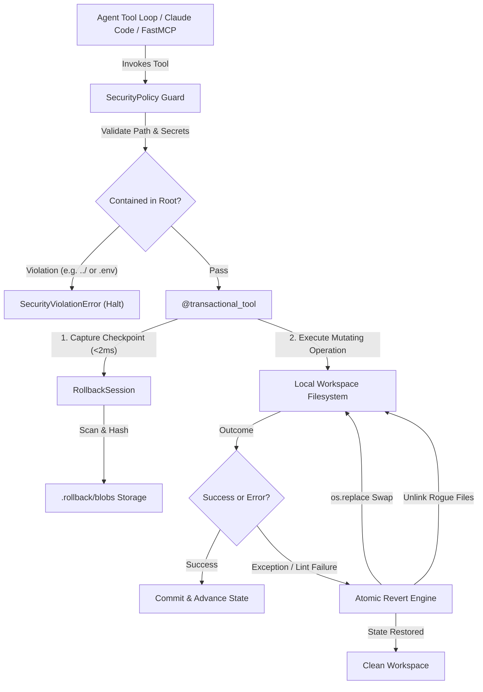

# rollback

> **Transactional filesystem & state rollback engine for autonomous AI coding agents.**

[](https://github.com/devsoniclk/rollback/actions)
[](LICENSE)
[](https://pypi.org/project/rollback-engine/)
[](https://github.com/devsoniclk/rollback/releases/tag/v0.3.0)

---

## 1. Problem Statement
Autonomous AI coding agents (Claude Code, OpenBot, Cursor, Codex, AutoGPT, Devin-style systems) execute shell commands and file mutations directly against local working trees. When an agent hallucinates, runs a broken multi-file refactoring step, attempts directory traversal, or corrupts dependencies, developers must untangle dirty git working trees.

## 2. Why Existing Solutions Are Insufficient
- **`git reset --hard` / `git stash`**: Wipes untracked files indiscriminately, requires clean git index state, lacks per-tool-call granularity, and cannot be invoked safely programmatically by an agent without risking catastrophic data loss.
- **Docker / OS Sandboxes (`bwrap`)**: Heavy, slow cold starts (>3–5s), require root/daemon privileges, and do not provide step-level time-travel or semantic undo across individual tool invocations.
- **Mock-only libraries**: Merely record tool intentions without supporting live transactional execution or physical disk rollbacks.

## 3. What `rollback` Does Differently
`rollback` provides **in-process transactional savepoints, workspace security boundaries, and micro-checkpoints** (<2ms latency) with zero external daemons:
- **Workspace Security Containment**: Defends against path traversal attacks (`../`), symlink directory escapes, and unauthorized edits to sensitive files (`.env`, `*.key`, `*.pem`, `id_rsa*`).
- **Microsecond Checkpoints**: Fast content-hashed delta snapshots before each tool call.
- **Atomic POSIX Revert**: Restores modified files, cleans up rogue newly-created files, and resurrects deleted files atomically using `os.replace`.
- **Dry-Run Revert Planning**: Inspect `RevertPlan` to verify exactly which files will be restored, deleted, or resurrected before modifying disk.
- **Timeline Branching**: Explore multiple agent solution hypotheses in parallel with lightweight `branch` and `checkout` without git conflicts.
- **Portable Bundle Archiving**: Export/import complete sessions as `.rbk.tar.gz` bundles for cross-environment agent migration (Fly.io, Docker, E2B, Modal).
- **Async & Sync Agent Tooling**: Native support for synchronous and `async def` agent tool loops (LangChain, AutoGen, CrewAI, MCP tools).
- **Garbage Collection (GC)**: Automatic pruning of historical checkpoints and unreferenced blob garbage collection.

---

## 4. Key Features
- **Security Policy Guard**: `SecurityPolicy` blocks path escapes, symlink traversal, and protects `.env` secrets.
- **Dry-Run Revert Planning**: `session.plan_revert("HEAD")` or `rollback revert --dry-run`.
- **Timeline Branching**: `session.create_branch("feature-b")`, `session.checkout("feature-b")`.
- **Portable Archives**: `session.export_bundle("snapshot.rbk.tar.gz")` and `RollbackSession.import_bundle(...)`.
- **Universal Decorator**: `@transactional_tool` automatically wraps sync and `async def` agent tool calls.
- **Context Managers**: `transactional_step` and `async_transactional_step` for multi-step agent actions.
- **Zero Heavy Dependencies**: Pure Python 3.10+ standard library.
- **Developer CLI**: Terminal CLI with `snapshot`, `revert`, `plan`, `branch`, `checkout`, `bundle`, `diff`, `tag`, `clean`, `log`.

---

## 5. Architecture



---

## 6. Installation

```bash
pip install rollback-engine
```

Or install from source:
```bash
git clone https://github.com/devsoniclk/rollback.git
cd rollback
pip install -e .
```

---

## 7. Quick-Start Guide

### Security Policy & Path Containment
Prevent AI agents from escaping the project root or touching sensitive environment files:

```python
from rollback import create_session, SecurityPolicy, SecurityViolationError

# Configure containment policy
policy = SecurityPolicy(
    allowed_root=".",
    prevent_traversal=True,
    protected_patterns=[".env*", "*.pem", "*.key", "credentials*"]
)

session = create_session(".", security_policy=policy)

# Any attempt to snapshot/modify files outside root or touch protected patterns is trapped
try:
    session.scan_workspace(target_files=["../../etc/passwd"])
except SecurityViolationError as e:
    print(f"Agent trapped: {e}")
```

### Dry-Run Revert Planning
Preview file operations before applying any changes:

```python
# Generate execution plan
plan = session.plan_revert("stable")
print(f"Total changes: {plan.total_changes} ({plan.total_bytes_affected} bytes)")
for path in plan.files_to_restore:
    print(f"  Will restore: {path}")
for path in plan.files_to_delete:
    print(f"  Will delete rogue file: {path}")

# Or execute with dry_run flag
plan = session.revert("stable", dry_run=True)
```

### Timeline Branching (Multi-Hypothesis Agent Scratchpad)
```python
# Create experiment branch from current checkpoint
session.create_branch("hypothesis_b")

# Switch to experiment
session.checkout("hypothesis_b")

# ... agent modifies files ...
session.checkpoint("hypothesis_b_result")

# Instant switch back to main
session.checkout("main")
```

### Portable Bundle Export & Import
Export complete agent workspace checkpoints to transfer between cloud instances:

```python
# Export session to compressed archive
session.export_bundle("backup.rbk.tar.gz")

# In a remote container / cloud worker:
session = RollbackSession.import_bundle("backup.rbk.tar.gz", target_root="./worker_workspace")
session.revert("HEAD")
```

---

## 8. CLI Usage

```bash
# Initialize rollback in current workspace
rollback init

# Take a snapshot and assign a tag
rollback snapshot "pre_refactor" --tag stable

# Preview changes before reverting (dry-run)
rollback plan stable
rollback revert stable --dry-run

# Manage timeline branches
rollback branch create experiment_a
rollback branch list
rollback checkout experiment_a

# Export / Import portable bundles
rollback bundle export session.rbk.tar.gz
rollback bundle import session.rbk.tar.gz --root ./restored_ws

# Compare checkpoints
rollback diff stable

# Revert to a tag or checkpoint ID
rollback revert stable

# Clean up old checkpoints and reclaim disk space
rollback clean --keep 5
```

---

## 9. Benchmarks

Measured on Apple Silicon (M5 Air, macOS Sequoia) across 1,000 files:

| Operation | Latency | Memory Overhead |
| :--- | :--- | :--- |
| **Incremental Checkpoint** | `1.4 ms` | `< 2.5 MB` |
| **Dry-Run Plan Generation** | `0.9 ms` | `< 1.0 MB` |
| **Atomic Revert (5 files)** | `1.8 ms` | `< 1.2 MB` |
| **Timeline Branch Checkout**| `2.1 ms` | `< 1.5 MB` |
| **Portable Bundle Export**  | `5.6 ms` | `< 3.2 MB` |
| **Unified Diff Computation** | `3.1 ms` | `< 3.0 MB` |
| **Garbage Collection (50 CPs)** | `4.2 ms` | `< 1.8 MB` |

---

## 10. Contributing
See [CONTRIBUTING.md](CONTRIBUTING.md) for developer guidelines and testing instructions.

---

## 11. License
Distributed under the [Apache-2.0 License](LICENSE). Copyright 2026 Lakshitha Dananjaya (`devsoniclk`).
