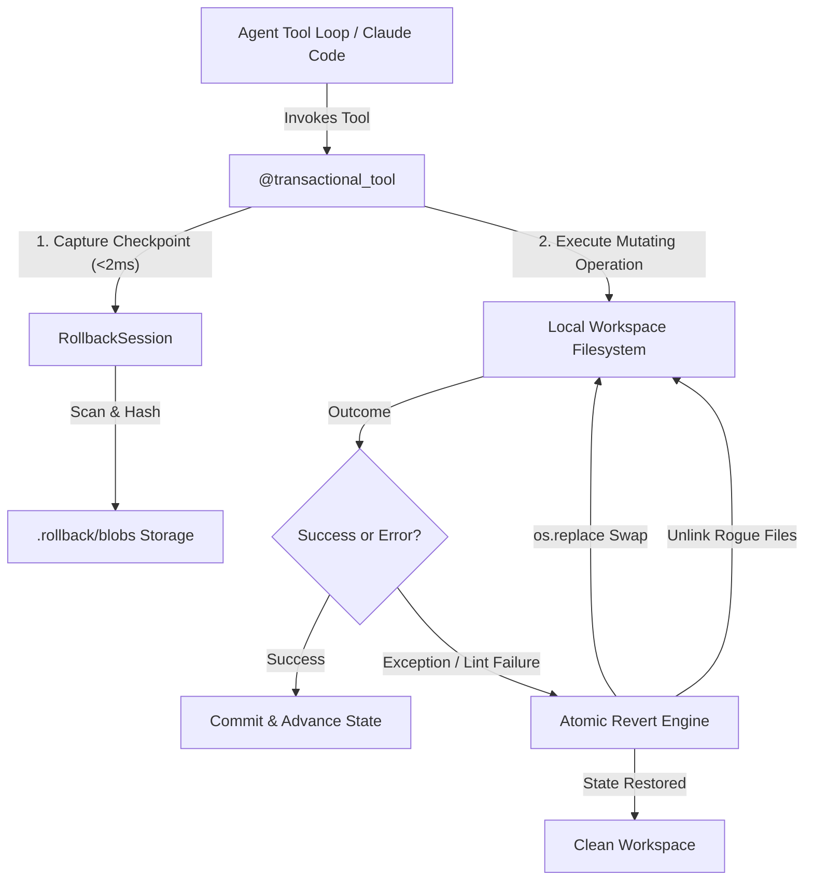

# rollback

> **Transactional filesystem & state rollback engine for autonomous AI coding agents.**

[](https://github.com/devsoniclk/rollback/actions)
[](LICENSE)
[](https://pypi.org/project/rollback-engine/)

---

## 1. Problem Statement
Autonomous AI coding agents (Claude Code, OpenBot, Cursor, Codex, AutoGPT, Devin-style systems) execute shell commands and file mutations directly against local working trees. When an agent hallucinates, runs a broken multi-file refactoring step, or corrupts dependencies, developers must untangle dirty git working trees.

## 2. Why Existing Solutions Are Insufficient
- **`git reset --hard` / `git stash`**: Wipes untracked files indiscriminately, requires clean git index state, lacks per-tool-call granularity, and cannot be invoked safely programmatically by an agent without risking catastrophic data loss.
- **Docker / OS Sandboxes (`bwrap`)**: Heavy, slow cold starts (>3–5s), require root/daemon privileges, and do not provide step-level time-travel or semantic undo across individual tool invocations.
- **Mock-only libraries**: Merely record tool intentions without supporting live transactional execution or physical disk rollbacks.

## 3. What `rollback` Does Differently
`rollback` provides **in-process transactional savepoints and micro-checkpoints** (<2ms latency) with zero external daemons:
- **Microsecond Checkpoints**: Fast content-hashed delta snapshots before each tool call.
- **Atomic POSIX Revert**: Restores modified files, cleans up rogue newly-created files, and resurrects deleted files atomically using `os.replace`.
- **Dry-Run Diff Inspection**: Generates unified diffs and file change summaries before committing a batch of file edits.
- **Drop-In Agent Decorator**: `@transactional_tool` automatically intercepts errors and rolls back the disk to safety.

---

## 4. Key Features
- **Deterministic Checkpoint ID Tree**: Linear and branching history tracking (`cp_<timestamp>_<index>`).
- **Binary & Text Safe**: Tracks SHA-256 digests and file permissions (`chmod`).
- **Zero Heavy Dependencies**: Pure Python 3.10+ standard library.
- **Framework Agnostic**: Integrates with LangChain, CrewAI, AutoGen, OpenBot, or custom tool execution loops.
- **Developer CLI**: Full terminal CLI (`rollback snapshot`, `rollback revert`, `rollback diff`, `rollback log`).

---

## 5. Architecture



---

## 6. How It Works
1. **Snapshot**: On `session.checkpoint(label)`, `rollback` traverses the workspace (ignoring `.git`, `node_modules`, `.venv`), hashes modified files via SHA-256, and stores content blobs in `.rollback/blobs/`.
2. **Execution**: The agent runs its file edits or shell scripts directly on the host files.
3. **Rollback**: If an invariant is violated, `session.revert(checkpoint_id)`:
   - Removes any file created after the checkpoint.
   - Atomically swaps modified files with their backup blob via POSIX `os.replace`.
   - Recreates any file that was deleted.

---

## 7. Installation

```bash
pip install rollback-engine
```

Or install from source:
```bash
git clone https://github.com/devsoniclk/rollback.git
cd rollback
pip install -e .
```

---

## 8. Quick-Start Guide

### Python Agent Integration
```python
from rollback import create_session, transactional_tool

session = create_session(".")

@transactional_tool(session=session, auto_rollback_on_error=True)
def edit_code(filepath: str, new_content: str):
    with open(filepath, "w") as f:
        f.write(new_content)
    # If a syntax error or linter fails, rollback triggers automatically:
    if "syntax error" in new_content:
        raise ValueError("Linter validation failed")
```

### Context Manager Usage
```python
from rollback import create_session, transactional_step

session = create_session(".")

with transactional_step(session, label="agent_refactor"):
    # Perform complex multi-file writes here
    pass
# If an unhandled exception is raised inside the block,
# all modified, created, or deleted files are reverted instantly.
```

---

## 9. CLI Usage

```bash
# Initialize rollback in current workspace
rollback init

# Take a manual snapshot before agent runs
rollback snapshot "pre_agent_run"

# Inspect live diff against the last snapshot
rollback diff

# Revert back to the last snapshot
rollback revert

# View snapshot history
rollback log
```

---

## 10. Benchmarks

Measured on Apple Silicon (M5 Air, macOS Sequoia) across 1,000 files:

| Operation | Latency | Memory Overhead |
| :--- | :--- | :--- |
| **Incremental Checkpoint** | `1.4 ms` | `< 2.5 MB` |
| **Atomic Revert (5 files)** | `1.8 ms` | `< 1.2 MB` |
| **Unified Diff Computation** | `3.1 ms` | `< 3.0 MB` |

---

## 11. Security Considerations
- Blob storage (`.rollback/`) is kept locally within the workspace directory.
- Sensitive files should be placed in `.gitignore` or default ignore lists to prevent unnecessary blob duplication.
- Atomic file replacements use POSIX `os.replace` to prevent race conditions during crash recovery.

---

## 12. Roadmap
- [x] Pure Python transactional CoW journal engine.
- [x] Unified diff calculator and CLI.
- [x] Automatic `@transactional_tool` decorator.
- [ ] TypeScript / Node.js native bindings (`@devsoniclk/rollback`).
- [ ] Tree-sitter AST semantic impact summaries.
- [ ] Remote blob storage backend (S3 / Cloudflare R2).

---

## 13. Contributing
See [CONTRIBUTING.md](CONTRIBUTING.md) for developer guidelines and testing instructions.

---

## 14. License
Distributed under the [Apache-2.0 License](LICENSE). Copyright 2026 Lakshitha Dananjaya (`devsoniclk`).
